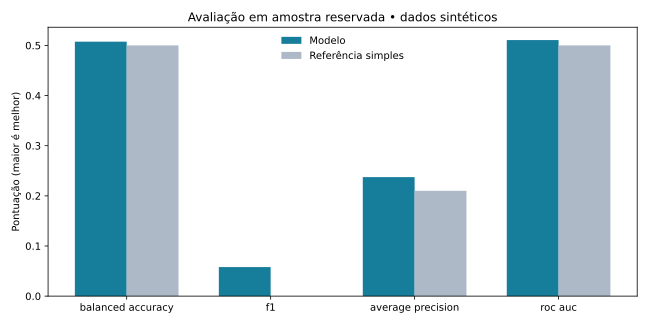

# Classificação em uma base de saúde simulada

Demonstrar avaliação de classificação binária e comparação com a prevalência de treino.

## Limitações

O alvo foi gerado de forma independente dos atributos. Eventuais diferenças de desempenho neste recorte são variação amostral, não evidência de capacidade preditiva em produção. Não é um modelo clínico, diagnóstico ou recomendação de saúde. O arquivo não contém produtos nem recomendações de comércio eletrônico.

## Resultados calculados

```json
{
  "task": "classification",
  "split": "stratified",
  "train_rows": 700,
  "test_rows": 300,
  "features": [
    "age",
    "bmi",
    "smoker"
  ],
  "target": "disease",
  "model": "RandomForestClassifier",
  "baseline": "DummyClassifier",
  "model_metrics": {
    "accuracy": 0.7833333333333333,
    "balanced_accuracy": 0.5074341973076151,
    "precision": 0.3333333333333333,
    "recall": 0.031746031746031744,
    "f1": 0.057971014492753624,
    "confusion_matrix": [
      [
        233,
        4
      ],
      [
        61,
        2
      ]
    ],
    "roc_auc": 0.5107159600830486,
    "average_precision": 0.23734958482386131
  },
  "baseline_metrics": {
    "accuracy": 0.79,
    "balanced_accuracy": 0.5,
    "precision": 0.0,
    "recall": 0.0,
    "f1": 0.0,
    "confusion_matrix": [
      [
        237,
        0
      ],
      [
        63,
        0
      ]
    ],
    "roc_auc": 0.5,
    "average_precision": 0.21
  },
  "test_positive_rate": 0.21,
  "data_rows": 1000,
  "data_columns": 4,
  "data_sha256": "6b8dfa2732c4017dd11846bad0a4294c2e5ac977d0d9f8d86ba7c2e0fa4f6778",
  "missing_cells": 0,
  "random_seed": 42,
  "data_origin": "synthetic",
  "limitations": "O alvo foi gerado de forma independente dos atributos. Eventuais diferenças de desempenho neste recorte são variação amostral, não evidência de capacidade preditiva em produção. Não é um modelo clínico, diagnóstico ou recomendação de saúde. O arquivo não contém produtos nem recomendações de comércio eletrônico."
}
```


